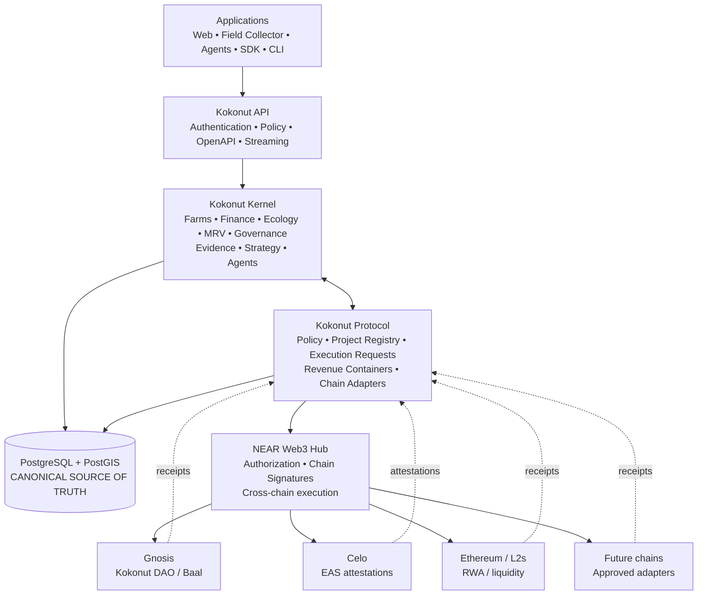
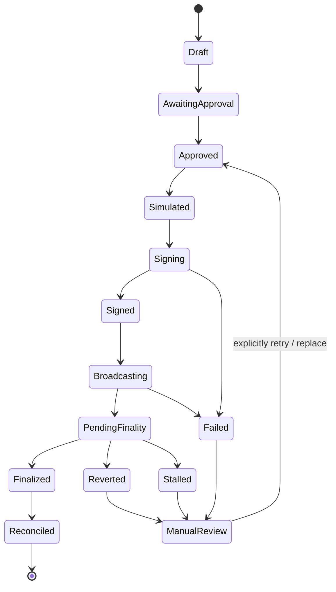
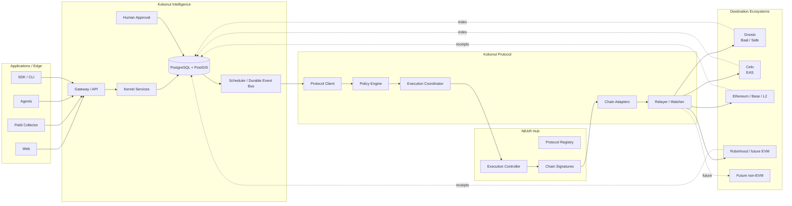
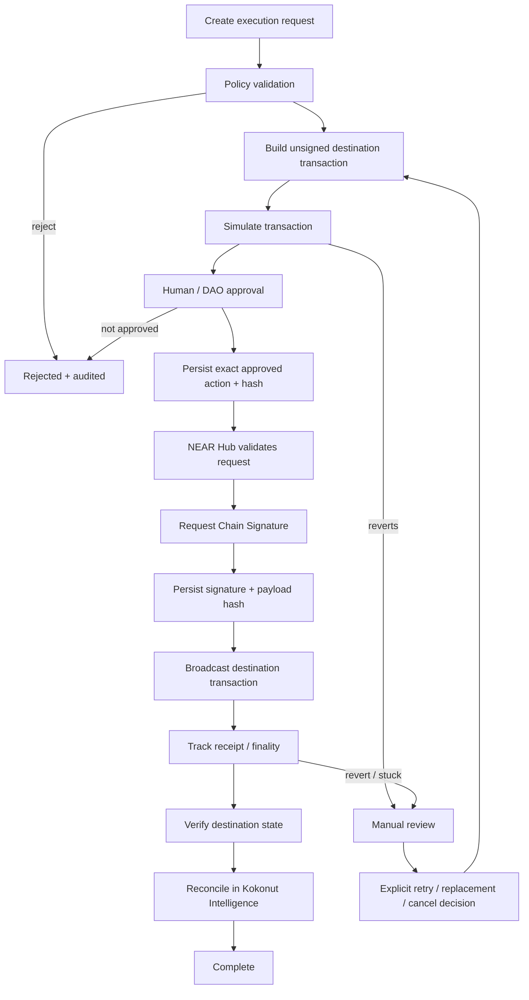
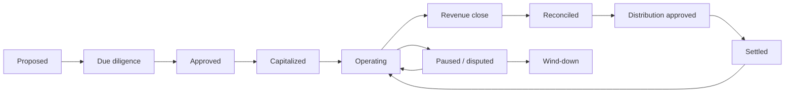
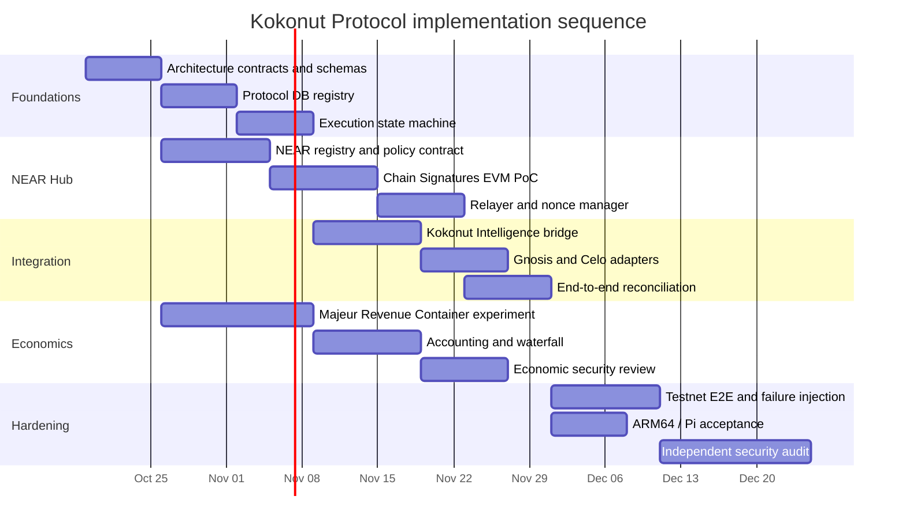

# Kokonut Protocol — Research-Backed Implementation PRD

**Status:** Implementation-ready product and architecture specification
**Product owner:** Kokonut Network
**Research date:** October 15, 2026
**Strategic decision:** NEAR Protocol becomes the Web3 interoperability hub for Kokonut Network
**Canonical operational system:** Kokonut Intelligence / PostgreSQL + PostGIS
**Initial economic product:** Revenue Containers, validated first through a controlled Majeur/Moloch experiment
**Initial execution scope:** EVM-first cross-chain deployment and transaction orchestration through NEAR Chain Signatures
**Audience:** Codex, Kokonut engineers, security reviewers, DAO stakeholders, auditors

## Executive summary

The research supports the central strategic thesis: **NEAR is a technically credible choice for the Web3 Hub of Kokonut Network**, specifically because Chain Signatures allow NEAR accounts and smart contracts to authorize signatures for transactions on external chains, while NEAR Intents provides a separate multichain asset-routing layer and NEAR's AI/TEE infrastructure can later provide confidential agent computation. NEAR documentation explicitly describes Chain Signatures as a way for NEAR accounts—including smart contracts—to sign transactions on multiple blockchain ecosystems using MPC. citeturn21view1turn20view0turn20view1

That does **not**, however, mean that NEAR magically turns every blockchain into one execution environment. Chain Signatures provide signing capability. Kokonut must still construct each destination-chain transaction, control nonces or sequence numbers, pay destination gas, broadcast it, wait for destination finality, verify the resulting state, and reconcile that outcome back into Kokonut Intelligence. NEAR's documented execution pattern is effectively **derive → construct → request signature → format → relay**, and the actual signed transaction is separately sent to the target network. citeturn20view1turn10search1

This distinction determines the proposed architecture:

> **Kokonut Intelligence owns truth. Kokonut Protocol owns cross-chain policy and execution. NEAR owns the interoperability/signing hub. Destination chains own local settlement and enforce local rights.**

Kokonut Intelligence should therefore remain the canonical operational, financial, evidence, approval, and audit system. This is already consistent with the repository's architectural principle that “the schema is the product” and that Web3 is a proof/coordination layer rather than the source of truth. Private evidence is already designed to remain off-chain by default. fileciteturn3file0

NEAR should **not** replace Gnosis, Celo, Ethereum, Base, Robinhood Chain, or future chains. Instead it should become the **cross-chain control plane** from which Kokonut can coordinate approved deployments and actions on them.

The resulting conceptual architecture is:



The existing Kokonut Intelligence repository makes this significantly easier than starting from zero. It already has a FastAPI gateway, checksummed PostgreSQL migrations, a durable PostgreSQL-backed scheduler/event bus with leases and dead-letter recovery, chain indexing, Celo EAS infrastructure, Gnosis/Baal indexing, agent safety controls, upgrade/recovery infrastructure, Foundry contracts, SDKs, and an active **Kokonut Kernel refactor**. fileciteturn3file0 fileciteturn16file0

The Kernel refactor is especially important. The repository already contains a standalone candidate deployment of **PostgreSQL/PostGIS + Kokonut app**, with Directus, ClickHouse, gRPC, Metabase, MQTT, and Prefect disabled by default. That is almost exactly the lightweight foundation previously proposed. fileciteturn10file0 fileciteturn23file0

So this PRD does **not** recommend rebuilding Kokonut Intelligence. It recommends extending the emerging Kernel with a clean Protocol boundary.

The recommended separation is:

| System | Responsibility | Source of truth? |
|---|---|---:|
| **Kokonut Intelligence / Kernel** | Farms, operations, evidence, finance, stakeholders, human approvals, audit, reports | **Yes** |
| **Kokonut Protocol** | Chain-neutral project manifests, execution policy, revenue-container abstractions, adapters | Protocol state only |
| **NEAR Hub** | Authorization and Chain Signature requests | No |
| **Destination chains** | Local contracts, custody, DAO rights, settlement | For their own on-chain state |
| **Celo EAS** | Public attestation anchors | No; proof layer |
| **Gnosis/Baal** | Existing DAO governance and treasury state | Yes for existing DAO on-chain rights |
| **NEAR Intents** | Optional cross-chain asset exchange/settlement | No |
| **NEAR AI** | Optional confidential/verifiable agent inference | No |

The existing Celo EAS decision should remain. EAS's official deployment repository currently lists Celo mainnet EAS v1.3.0 at the same EAS and SchemaRegistry addresses documented by Kokonut Intelligence, while Gnosis is not listed among the official mainnet deployments. This validates the existing Celo integration rather than creating a reason to migrate it immediately. citeturn23search0 fileciteturn3file0

The existing Kokonut DAO should likewise **remain on Gnosis**. The purpose of NEAR is to remove the need to migrate every subsystem to a single chain.

For Revenue Containers, the research changes one important part of the original idea. **New project participants should not automatically receive Ragequit rights against the existing Kokonut DAO treasury.** Moloch/Baal Shares include governance and exit rights, while Loot represents economic/exit rights without DAO administrative power; Moloch-style Ragequit is fundamentally a claim against assets held in the applicable treasury. citeturn22search4turn22search7

The safer architecture is:

> **One project-specific Revenue Container → one segregated project treasury/accounting boundary → optional project-specific Moloch/Majeur economic rights.**

The existing Kokonut DAO can govern Protocol standards and capital allocation without automatically exposing unrelated DAO assets to each project's Ragequit mechanism.

Majeur is suitable as an **experimental PMF vehicle**, not yet as an unquestioned production dependency. The researched framework builds on Moloch-style Shares/Loot/Ragequit and provides useful modules, but its own security materials do not substitute for a fresh independent manual audit for Kokonut's particular economic configuration. citeturn14search0turn14search2

Finally, the “quantum-resistant NEAR” thesis requires precise language. NEAR has shipped support for post-quantum account transaction signing through ML-DSA, but NEAR's own quantum roadmap distinguishes that from consensus and from Chain Signatures; cross-chain Chain Signatures still depend on classical signature schemes such as ECDSA/EdDSA. **Kokonut must therefore describe the architecture as quantum-migration-aware, not fully post-quantum.** citeturn18search0turn18search2

The product-level conclusion is strong:

> **Build Kokonut Protocol as an interoperability protocol, not another blockchain.**
>
> **Use NEAR as the policy-controlled signing hub.**
>
> **Keep Kokonut Intelligence canonical.**
>
> **Keep assets and rights native to the chains where they make the most sense.**
>
> **Make every new chain an adapter, not a new architecture.**

## Research findings and design constraints

### NEAR Chain Signatures

NEAR's official documentation explicitly identifies Chain Signatures as an MPC-based mechanism through which NEAR accounts and smart contracts can sign transactions for external blockchain ecosystems. The documentation includes examples spanning EVM networks and non-EVM systems, and the official implementation flow separates address derivation, transaction construction, signature request, transaction formatting, and relay. citeturn21view1turn20view0turn20view1

The current production signing contract documented by NEAR is `v1.signer` on mainnet; NEAR also documents a production-style signer contract for testnet development. Chain Signatures support different signing schemes, including secp256k1 and Ed25519 pathways. citeturn20view0turn20view1

A derived destination-chain address depends on the NEAR caller/account, the derivation path, and the MPC key. NEAR explicitly recommends careful derivation-path separation, and its documentation discusses replay implications where destination payloads do not otherwise bind themselves to a chain; EVM EIP-155 chain IDs supply one such boundary. citeturn20view0

This gives Kokonut an important capability:

```text
Kokonut Protocol
      │
      │ approve structured action
      ▼
NEAR Hub Contract
      │
      │ request MPC signature
      ▼
NEAR Chain Signatures
      │
      │ signature
      ▼
Kokonut Relayer / Adapter
      │
      │ signed transaction
      ▼
Destination Chain
```

It does **not** provide:

- Cross-chain atomicity.
- Destination-chain gas.
- Destination-chain nonce management.
- Guaranteed transaction inclusion.
- Automatic destination-chain contract semantics.
- Automatic bridging of assets back to NEAR.
- Proof that a real-world event occurred merely because a transaction was signed.

NEAR's own documentation describes Chain Signatures as effectively an outbound signing capability; incoming external-chain state still requires indexing, bridges, or other verification mechanisms. citeturn20view0

The implementation must therefore model these as different events:



**A signature is not execution. A transaction hash is not finality. Finality is not reconciliation.**

That distinction must become a Protocol invariant.

### NEAR Intents

NEAR Intents is strategically useful to Kokonut, but for a different job.

Official NEAR documentation describes Intents as infrastructure for high-level multichain financial operations involving deposits, swaps, solver responses, withdrawals, and multichain settlement. Intents currently uses bridge infrastructure including Omni Bridge and PoA-based mechanisms, and the documented Omni Bridge support includes networks such as Ethereum, Base, Arbitrum, Bitcoin, Solana, and TON. citeturn22search0turn22search3turn22search12

Therefore:

**Chain Signatures = arbitrary authorized chain transaction signing.**

**Intents = asset exchange and settlement routing.**

Kokonut should never couple farm deployment to Intents.

Instead:

```text
Protocol Execution
    └── Chain Signatures

Protocol Settlement
    └── optional NEAR Intents

Protocol Attestations
    └── EAS / chain-local proof systems

Protocol Governance
    └── local DAO adapter

Protocol Intelligence
    └── Kokonut Intelligence
```

A material operational constraint is that NEAR's current Intents documentation states there is **no testnet deployment and no planned testnet deployment**; testing is recommended using isolated accounts on mainnet. citeturn22search2

Therefore Intents is explicitly **not a P0 dependency** for the Protocol MVP.

Any later Intents integration begins with low-value mainnet tests after separate approval.

### NEAR AI and agent infrastructure

NEAR's current ecosystem offers confidential computation and TEE-backed inference infrastructure. Official NEAR documentation also now includes verifiable off-chain compute primitives such as OutLayer, which runs code in trusted execution environments and exposes attestation facilities. citeturn21view1

Current NEAR AI materials describe confidential inference using TEE-backed infrastructure, hardware attestation, and developer-facing model APIs. citeturn16search1turn16search2

This is relevant to the future **Kokonut Syntropic Agent**, particularly for:

- Private farm-data inference.
- Confidential investment analysis.
- Agent policy reasoning.
- Transaction simulation.
- Proposal drafting.
- Cross-chain monitoring.

It does not change Kokonut's existing human-approval boundary.

The Kokonut Intelligence repository currently establishes that agents may draft and submit governed records but cannot independently verify, publish, attest, or score governed outputs. fileciteturn2file0

Kokonut Protocol extends that rule:

```text
AGENT MAY
────────────
read authorized state
analyze
simulate
draft deployment
prepare transaction
prepare distribution
detect anomalies
submit execution request

AGENT MAY NOT, BY DEFAULT
─────────────────────────
approve its own transaction
release treasury funds
mint economic rights
change protocol policy
finalize MRV verification
publish governed financial claims
execute Ragequit for another holder
upgrade Protocol contracts
```

A TEE proves something about a computational environment; it does not turn an AI decision into a governance authorization. NEAR's own recent security discussion also distinguishes general enclave attestation from proof that a specific request actually traversed that enclave unless the request/response path itself provides such evidence. citeturn16search9

### EAS and Celo

Kokonut's existing Celo integration is sound.

EAS describes itself as an open protocol for registering schemas and making attestations on EVM-compatible blockchains. Its official deployment repository lists Celo mainnet v1.3.0 with:

| Component | Celo address |
|---|---|
| EAS | `0x72E1d8ccf5299fb36fEfD8CC4394B8ef7e98Af92` |
| SchemaRegistry | `0x5ece93bE4BDCF293Ed61FA78698B594F2135AF34` |
| EIP-712 Proxy | `0x6792B6AE17c6416016b943585e957a29bc452806` |
| Indexer | `0x76591b332d0F099E89FA335fC827D44C47705D2f` |

These official EAS addresses match the EAS and SchemaRegistry addresses documented in Kokonut Intelligence. citeturn23search0 fileciteturn3file0

The current Kokonut architecture documents seven Celo EAS schemas covering MRV, impact, financial, harvest, compliance, biological batch, and data-post use cases. fileciteturn3file0

EAS also provides its own indexing implementation for EVM networks with deployed EAS contracts. citeturn23search2

The Protocol should therefore **federate attestations rather than relocate them**.

Canonical identity should be:

```text
canonical Kokonut claim
        │
        ├── Celo EAS attestation
        ├── future Ethereum EAS attestation
        ├── future Base attestation
        └── other proof representation
```

not:

```text
Celo claim
Ethereum claim
Base claim
NEAR claim
```

The latter would introduce double-counting risk.

### Gnosis, Baal, Shares, Loot, and Ragequit

Baal/Moloch v3 is explicitly designed as a composable DAO architecture. The canonical Baal documentation describes **Shares** as having governance/voting plus exit rights, while **Loot** has exit/economic rights without equivalent administrative governance power. citeturn22search4

Moloch-style Ragequit burns an economic membership instrument in exchange for a proportional claim against specified treasury assets. The Moloch Ragequit repository describes the classic mechanism as a fair-share treasury redemption. citeturn22search7

Kokonut Intelligence already contains a dedicated Baal read client, a Gnosis Baal indexer, an indexed governance ledger, and migrations specifically supporting idempotent Baal ingestion. fileciteturn17file0 fileciteturn17file1 fileciteturn17file11 fileciteturn17file12

Therefore the existing DAO integration should become a **Protocol governance adapter**, not be rewritten.

The critical economic implication is:

> A Ragequit right should only reach assets whose treasury and liability structure is intentionally backing that right.

This is why the proposed Revenue Container model uses **project-specific treasury isolation**.

### MajeurDAO

Majeur's researched framework is closely aligned with the experiment Kokonut wants to conduct: Moloch-style treasury governance, Shares/Loot economics, Ragequit, summoning/deployment utilities, and modular capital mechanisms. citeturn14search0

The framework is therefore a good candidate for the **experimental Revenue Container phase**.

It is not yet approved as Kokonut Protocol's permanent economic implementation.

The security evidence reviewed includes automated analysis and verification materials, but the research did not establish an independent, comprehensive manual audit whose scope can simply be inherited by a revenue-bearing Kokonut production deployment. Majeur itself should therefore be treated as an external experimental dependency until a pinned version and Kokonut-specific security assessment are approved. citeturn14search0turn14search2

The two exploratory Kokonut smart-contract documents supplied for this research reach similar conceptual territory: MRV anchoring, milestone escrow, revenue waterfalls, treasury controls, outcome rewards, and Ragequit-compatible economics. Those documents are useful **design hypotheses**, not accepted tokenomics. fileciteturn0file0 fileciteturn0file1

In particular, illustrative percentage allocations and predicted yield figures from exploratory material are **not incorporated into this PRD**.

### Quantum resistance and sharding

The “future-proof” thesis is directionally defensible but must be stated precisely.

NEAR has introduced support for post-quantum transaction signatures using ML-DSA for account/access-key transaction signing. NEAR's own specification narrows that scope; it does not mean every consensus or cross-chain cryptographic primitive has become post-quantum. citeturn18search2

NEAR's published quantum roadmap explicitly notes that Chain Signatures still rely on classical ECDSA/EdDSA cryptography and that post-quantum threshold-signature infrastructure remains a future research/development area. citeturn18search0

Therefore Kokonut marketing and architecture documentation must use:

> **Quantum-migration-aware**

rather than:

> ~~Fully quantum-resistant cross-chain Protocol~~

NEAR's sharding architecture remains a separate scalability advantage; current nearcore development has included dynamic resharding capability. This is useful for hub scalability but does not remove destination-chain bottlenecks. citeturn17search7

### Research limitations

The requested Kokonut Network `llms.txt` endpoint could not be fetched by the research environment. No architectural conclusion in this PRD depends solely on that unavailable source.

The connected `Kokonut-Agentic-Marketplace` repository currently exposes an empty default-branch root, so this PRD deliberately does **not** invent Marketplace APIs or contract boundaries. fileciteturn9file0

The Protocol treats Marketplace/Syntropic integration as a future adapter until an executable interface exists.

## Product definition and recommended architecture

### Product statement

**Kokonut Protocol is the chain-agnostic policy, deployment, economic coordination, and cross-chain execution protocol for Kokonut Network.**

Its job is to let an authorized Kokonut project launch and operate in the ecosystems most useful to its stakeholders without changing Kokonut's underlying operating methodology every time another chain becomes strategically relevant.

A farm should become:

```text
Kokonut Farm
├── canonical identity
├── physical location
├── local operating entity
├── Kokonut Framework configuration
├── Kokonut Intelligence records
├── stakeholders
├── evidence / MRV
├── financing model
├── revenue container
├── governance adapter
├── treasury adapter
├── attestation adapter
└── one or more blockchain deployments
```

The blockchain deployment is therefore **one facet of the farm**, not the farm itself.

### Goals

The Protocol must enable:

| Goal | MVP requirement |
|---|---|
| Chain-neutral project definition | Yes |
| NEAR-controlled cross-chain transaction signing | Yes |
| EVM contract deployment | Yes |
| Destination transaction simulation | Yes |
| Durable execution/reconciliation | Yes |
| Celo EAS federation | Yes |
| Existing Gnosis DAO state integration | Yes |
| Revenue Container accounting | Yes |
| Majeur PMF experiment | Yes, isolated |
| Ragequit/economic-right abstraction | Pilot |
| Intents settlement | Optional P1 |
| NEAR AI integration | Optional P1 |
| Non-EVM destination execution | P2 |
| Autonomous financial agents | No |

### Non-goals

The first release will not:

- Migrate Kokonut DAO from Gnosis.
- Migrate existing EAS attestations from Celo.
- Require every project to use the same destination chain.
- Give NEAR custody of all Kokonut assets.
- Run a NEAR validator or MPC node as part of Kokonut Kernel.
- Promise universal compatibility with all blockchains.
- Guarantee financial yield.
- Tokenize land title by default.
- Allow an AI agent to independently authorize material financial transactions.
- Couple contract deployment to NEAR Intents.
- Treat an on-chain attestation as independent proof that an off-chain claim is true.
- Expose existing Kokonut DAO assets to new project Ragequit rights without explicit DAO approval.

### Branded system model

> Note: The original PNG/SVG assets for this figure were supplied as sandbox-only paths and are not present in this repository; no replacement asset is available here.

The core design principle remains:

> **Capabilities are permanent. Implementations are replaceable.**

The Kernel already moves toward this model. The candidate Compose deployment contains only PostgreSQL/PostGIS and the application by default, with Directus, ClickHouse, gRPC, Metabase, MQTT, and Prefect disabled through feature flags. fileciteturn23file0

### Logical architecture



### Authority model

There must be **three independent layers of authorization**.

#### Kokonut Intelligence authorization

Determines:

- Who may request an action.
- Whether required evidence exists.
- Whether human review occurred.
- Whether the relevant project/farm is active.
- Whether the requested operation fits policy.
- Whether budget/reserve limits permit it.

#### NEAR Hub authorization

Determines:

- Whether the caller can request a Chain Signature.
- Whether the destination chain is enabled.
- Whether the project is approved.
- Whether the operation type is allowlisted.
- Whether destination/value/spending constraints are satisfied.
- Whether the request has expired.
- Whether the request identifier has already been used.

#### Destination-chain authorization

Determines:

- Whether the signed address is permitted.
- Whether a factory can deploy the requested implementation.
- Whether the requested contract function is permitted.
- Whether spending caps are enforced.
- Whether the local treasury/governance system approves the operation.

**No one layer is sufficient by itself.**

### Cross-chain execution contract

A canonical execution request must resemble:

```json
{
  "protocol_version": "1",
  "request_id": "uuid",
  "project_id": "uuid",
  "chain_namespace": "eip155",
  "chain_id": "8453",
  "operation": "deploy_project_component",
  "target": "0x...",
  "value_base_units": "0",
  "calldata_hash": "0x...",
  "nonce": "123",
  "gas_policy": {
    "max_fee": "...",
    "max_priority_fee": "..."
  },
  "expires_at": "...",
  "policy_version": "protocol-policy-v1",
  "idempotency_key": "..."
}
```

The execution flow is:



### Adapter contract

The Protocol SDK must expose a common interface:

```typescript
interface ChainAdapter {
  readonly namespace: string;

  getCapabilities(): Promise<ChainCapabilities>;
  deriveAddress(input: DerivationRequest): Promise<DerivedAddress>;
  getNonce(input: NonceRequest): Promise<string>;
  estimateFees(action: ProtocolAction): Promise<FeeEstimate>;
  buildUnsigned(action: ProtocolAction): Promise<UnsignedTransaction>;
  simulate(tx: UnsignedTransaction): Promise<SimulationResult>;
  hashForSigning(tx: UnsignedTransaction): Promise<SigningPayload>;
  assembleSigned(
    tx: UnsignedTransaction,
    signature: ChainSignature,
  ): Promise<SignedTransaction>;
  broadcast(tx: SignedTransaction): Promise<BroadcastResult>;
  getTransactionStatus(txId: string): Promise<TransactionStatus>;
  waitForFinality(txId: string): Promise<FinalityResult>;
  verifyEffect(expectation: ExpectedEffect): Promise<VerificationResult>;
}
```

The P0 implementation is:

```text
ChainAdapter
    └── EvmChainAdapter
            ├── Gnosis
            ├── Celo
            ├── Base
            ├── Ethereum
            └── any approved EVM network
```

Support for a chain is declared only after its capability tests pass.

The EVM adapter should be configuration-driven where possible:

```yaml
chain:
  namespace: eip155
  chain_id: 100
  name: gnosis
  signing_scheme: secp256k1
  confirmations_required: 12
  rpc_secret_ref: gnosis-primary
  explorer_type: blockscout
  capabilities:
    contract_deploy: true
    eas: false
    safe: true
    baal: true
    intents_settlement: false
```

### NEAR Hub contracts

The minimum NEAR Hub should contain three conceptual modules, whether deployed as one contract initially or separated later:

```text
KokonutProtocolHub
├── ProjectRegistry
├── PolicyController
└── ExecutionController
```

`ProjectRegistry` stores only minimal public Protocol state:

- Canonical project identifier hash.
- Approved profile hash.
- Active status.
- Approved chains.
- Signer derivation policy.

`PolicyController` stores:

- Operator/approver roles.
- Allowed operations.
- Per-project/per-chain limits.
- Destination allowlists.
- Emergency pause.
- Versioned policy hashes.

`ExecutionController` stores:

- Request identifiers.
- Approved action commitments.
- Signing status.
- Replay protection.
- Chain Signature request metadata.
- Relevant event logs.

It should **not** store:

- Farm financial statements.
- Raw MRV evidence.
- Personal information.
- Full stakeholder data.
- Sensitive project documents.
- Private revenue records.

Those remain in Kokonut Intelligence.

### Signer strategy

Use derivation paths that are structurally separated at least by:

```text
kokonut/
  protocol-version/
    project-id/
      chain-namespace/
        chain-id/
          purpose/
```

Example conceptual path:

```text
kokonut/v1/project/<UUID>/eip155/8453/deployer
```

A different purpose must use a different path:

```text
.../deployer
.../operator
.../settlement
```

Do not share one derived EVM signer across every Kokonut project and chain.

### Destination ownership

The Chain Signature-derived account should preferably act as a **deployment/execution authority**, not permanent sole treasury owner.

Preferred deployment:

```text
NEAR-derived signer
        │
        │ calls allowlisted factory
        ▼
Project Factory
        │
        ├── deploy project contract
        ├── configure project ID
        └── set permanent admin
                 │
                 ▼
          Project Safe / DAO
```

This allows NEAR to coordinate deployment without turning the cross-chain signer into the permanent custodian of all farm assets.

### Revenue Container architecture

Revenue Containers are the first economic primitive to validate.

The lifecycle is:



The revenue waterfall starts from **realized and reconciled cash**, not projected yield:

```text
Realized Gross Receipts
    - refunds / reversals
    - direct operating expenses
    - taxes / statutory obligations
    - contractual liabilities
    - approved reserve funding
    = distributable cash

Distributable Cash
    → approved beneficiary allocations
    → optional DAO/project allocation
    → settlement
```

The exploratory Kokonut contract documents proposed several possible revenue and impact mechanisms, but their example percentages and financial assumptions are intentionally not hard-coded here. fileciteturn0file0 fileciteturn0file1

### Majeur pilot recommendation

The recommended experiment is:

```text
Kokonut Intelligence
       │
       │ real accounting
       ▼
Revenue Container Pilot
       │
       ├── project-specific treasury
       ├── Majeur / Moloch implementation
       ├── Shares or Loot
       └── Ragequit
```

Not:

```text
new farm investors
       │
       ▼
economic token
       │
       ▼
existing Kokonut DAO treasury
```

The Protocol must keep these instruments distinct:

| Instrument | Meaning |
|---|---|
| Distribution entitlement | Claim on a declared distribution |
| Stablecoin/native-token payment | Asset received after settlement |
| Moloch Loot | Economic/exit right according to DAO configuration |
| Moloch Shares | Governance + economic/exit rights |
| Reputation | Contribution/governance signal |
| Project token | Whatever explicit legal/economic rights its terms define |
| Existing Kokonut DAO membership | Existing DAO governance/economic rights |

A Revenue Container may eventually combine some of these, but they must never be silently treated as equivalent.

## Data, repositories, and implementation specification

### Canonical data model

The following tables are proposed additions to **Kokonut Intelligence PostgreSQL**.

At the inspected Kernel baseline, migration evidence reaches schema migration `379_noi_snapshot_crop_cycle_key.sql`, with 370 applied schema migrations reported in the active candidate. The implementation must re-check `main` immediately before creating a migration; assuming no newer migration has landed, Protocol migrations begin at `380`. fileciteturn20file0 fileciteturn20file1

#### Protocol registry

| Table | Important columns | Invariants |
|---|---|---|
| `protocol_chain` | `id`, `namespace`, `chain_id`, `name`, `family`, `finality_policy`, `capabilities`, `status` | `(namespace, chain_id)` unique |
| `protocol_project` | `id`, `farm_id`, `project_type`, `jurisdiction`, `status`, `active_profile_id` | canonical `farm_id` reference |
| `protocol_deployment_profile` | `id`, `project_id`, `version`, `config`, `config_hash`, `status` | approved versions immutable |
| `protocol_signer_binding` | `project_id`, `chain_id`, `near_account_id`, `derivation_path`, `scheme`, `derived_address`, `key_version`, `status` | no ambiguous active binding |
| `protocol_deployment` | `project_id`, `chain_id`, `component`, `version`, `address`, `tx_hash`, `code_hash`, `admin_address`, `status` | project+chain+component+version unique |

### Execution ledger

| Table | Important columns | Invariants |
|---|---|---|
| `protocol_execution_request` | `id`, `project_id`, `chain_id`, `operation`, `action_json`, `action_hash`, `idempotency_key`, `state`, `expires_at`, `policy_version` | idempotency unique |
| `protocol_execution_approval` | `request_id`, `actor_id`, `actor_role`, `decision`, `approved_hash`, `created_at` | approval binds exact action hash |
| `protocol_execution_attempt` | `request_id`, `attempt_no`, `nonce`, `near_tx_hash`, `signing_payload_hash`, `destination_tx_hash`, `state`, `error_code` | unique attempt number; append-oriented history |
| `protocol_execution_effect` | `request_id`, `effect_type`, `expected_value`, `observed_value`, `verified_at` | request cannot become reconciled without required effects |

Suggested state vocabulary:

```text
draft
awaiting_approval
approved
simulated
signing
signed
broadcast
pending_finality
finalized
reconciled

rejected
reverted
failed
stalled
manual_review
cancelled
```

Never collapse these into generic `success/failed`.

### Revenue Container ledger

| Table | Important columns | Invariants |
|---|---|---|
| `protocol_revenue_container` | `project_id`, `legal_entity_ref`, `governance_mode`, `treasury_ref`, `settlement_asset`, `status` | one active economic boundary per configured container |
| `protocol_revenue_period` | `container_id`, `starts_at`, `ends_at`, `gross`, `refunds`, `expenses`, `taxes`, `liabilities`, `reserves`, `distributable`, `status` | closed periods immutable |
| `protocol_waterfall_policy` | `container_id`, `version`, `rules`, `rules_hash`, `effective_from`, `status` | applied versions immutable |
| `protocol_distribution` | `period_id`, `beneficiary_id`, `asset`, `amount_base_units`, `status`, `execution_request_id` | no duplicate entitlement |
| `protocol_economic_right` | `container_id`, `holder_id`, `instrument_type`, `chain_id`, `contract`, `quantity_base_units`, `status`, `terms_ref` | explicit instrument semantics |
| `protocol_redemption` | `economic_right_id`, `snapshot_ref`, `burn_amount`, `received_assets`, `tx_hash`, `status` | economic value cannot be redeemed twice |

All token quantities should use exact integer base units—e.g. `NUMERIC(78,0)`—plus separately stored token decimals and asset identity.

Never use floating-point values for financial rights.

### Attestation federation

Add:

| Table | Purpose |
|---|---|
| `protocol_attestation_reference` | Map canonical Kokonut claim/evidence objects to chain-qualified attestations |

Required identity:

```text
canonical_subject_type
canonical_subject_id
chain_namespace
chain_id
attestation_contract
attestation_uid
schema_uid
issuer
issued_at
revoked_at
expiration
```

The existing `attestation_record` model, EAS indexer, evidence lineage infrastructure, and SDK support should be reused rather than creating a competing attestation database. fileciteturn19file0 fileciteturn19file2 fileciteturn19file8

### Exact Kokonut Intelligence repository changes

The initial implementation should add or modify the following.

| Path | Change |
|---|---|
| `schemas/postgres/380_protocol_registry.sql` | Add chain, project, profile, signer, deployment tables |
| `schemas/postgres/381_protocol_execution.sql` | Execution request, approval, attempt, effects ledger |
| `schemas/postgres/382_protocol_revenue_container.sql` | Revenue, waterfall, distribution, rights, redemption |
| `schemas/postgres/383_protocol_attestation_federation.sql` | Chain-qualified claim/attestation relationships |
| `schemas/postgres/384_protocol_policy_security.sql` | RLS/constraints/agent-safety triggers |
| `services/protocol/__init__.py` | Package boundary |
| `services/protocol/models.py` | Pydantic/domain models |
| `services/protocol/repository.py` | Canonical PostgreSQL persistence |
| `services/protocol/policy.py` | Authorization and execution-policy evaluation |
| `services/protocol/registry.py` | Projects/chains/profiles/deployment registry |
| `services/protocol/execution.py` | Execution state machine |
| `services/protocol/revenue.py` | Revenue reconciliation/waterfall preparation |
| `services/protocol/reconciliation.py` | NEAR + destination-chain receipt reconciliation |
| `services/protocol/events.py` | Durable event handlers |
| `services/protocol/client.py` | Typed Kokonut-Protocol client |
| `services/protocol/cli.py` | Operator commands |
| `services/protocol/README.md` | Local architecture/module contract |
| `services/ingestion/near_indexer.py` | Index relevant Hub contract events |
| `services/ingestion/cli.py` | Register NEAR indexing command |
| `services/cli.py` | Mount Protocol CLI |
| `services/gateway/` | Add versioned Protocol HTTP routes using current gateway conventions |
| `services/governance/baal.py` | Extend only where Protocol needs existing state |
| `services/ingestion/baal_indexer.py` | Add Protocol correlation IDs if required |
| `services/ingestion/eas_indexer.py` | Add canonical Protocol claim linking |
| `tests/test_protocol_registry.py` | Registry invariants |
| `tests/test_protocol_policy.py` | Authorization/capability boundaries |
| `tests/test_protocol_execution.py` | Execution state machine |
| `tests/test_protocol_revenue.py` | Waterfall/economic accounting |
| `tests/test_protocol_reconciliation.py` | Cross-chain reconciliation |
| `tests/test_protocol_agent_safety.py` | Agent financial-action denial |
| `tests/test_protocol_schema.py` | SQL constraints/migration checks |
| `docs/protocol/architecture.md` | Protocol/KI boundary |
| `docs/protocol/revenue-containers.md` | Economic specification |
| `docs/protocol/threat-model.md` | Security model |
| `docs/protocol/runbook.md` | Operator recovery |
| `docs/protocol/chain-adapters.md` | Capability/adapter contract |
| `.env.example` | Protocol RPC/public config—not secrets |
| `Makefile` | Protocol-focused test targets |
| `.onedev-buildspec.yml` | Protocol and ARM64 acceptance jobs |

The existing event subsystem already implements durable processing, retries/dead-letter handling, leases, and replay tooling. Protocol execution should reuse it rather than introducing Prefect, Temporal, Kafka, or another workflow product. fileciteturn16file0 fileciteturn16file2 fileciteturn16file3

### New Kokonut Protocol repository

Create:

```text
Kokonut-Protocol/
├── AGENTS.md
├── README.md
├── LICENSE
├── Makefile
├── contracts/
│   ├── near/
│   │   ├── Cargo.toml
│   │   ├── src/
│   │   │   ├── lib.rs
│   │   │   ├── registry.rs
│   │   │   ├── policy.rs
│   │   │   ├── execution.rs
│   │   │   └── events.rs
│   │   └── tests/
│   └── evm/
│       ├── foundry.toml
│       ├── src/
│       │   ├── KokonutProjectFactory.sol
│       │   ├── KokonutProjectRegistry.sol
│       │   ├── KokonutRevenueAdapter.sol
│       │   └── interfaces/
│       ├── script/
│       └── test/
│
├── packages/
│   ├── chain-signatures/
│   │   └── src/
│   ├── chain-adapters/
│   │   └── src/
│   │       ├── types.ts
│   │       ├── evm.ts
│   │       └── registry.ts
│   └── protocol-sdk/
│       └── src/
│
├── services/
│   └── relayer/
│       ├── src/
│       │   ├── worker.ts
│       │   ├── nonce-manager.ts
│       │   ├── broadcaster.ts
│       │   ├── finality.ts
│       │   └── health.ts
│       └── test/
│
├── integrations/
│   ├── moloch/
│   ├── majeur/
│   ├── eas/
│   └── intents/
│
├── specs/
│   ├── execution-request.schema.json
│   ├── deployment-profile.schema.json
│   ├── chain-capabilities.schema.json
│   ├── derivation-path-v1.md
│   └── events.md
│
├── deployments/
│   ├── testnet/
│   └── mainnet/
│
├── docs/
│   ├── architecture.md
│   ├── threat-model.md
│   ├── economic-invariants.md
│   ├── chain-onboarding.md
│   └── runbooks/
│
└── audits/
    └── README.md
```

### Repository ownership boundary

This boundary is mandatory:

```text
Kokonut-Intelligence
    owns:
        canonical project state
        accounting
        evidence
        human approvals
        policy inputs
        audit / reports

Kokonut-Protocol
    owns:
        chain codecs/adapters
        NEAR Hub contract
        destination factory contracts
        cross-chain signing client
        broadcasting/finality logic
        Protocol SDK
        contract deployment artifacts

Majeur / EAS / DAOhaus / NEAR
    remain external dependencies/adapters
```

**Do not copy canonical farm/financial state into Kokonut-Protocol.**

## Delivery plan, deployment profiles, and Codex checklist

### Implementation sequence



Dates are planning targets rather than contractual launch dates.

### Pull-request plan for Codex

#### Protocol foundation PR

**Repository:** `Kokonut-Protocol`

Deliver:

- Repository scaffold.
- `AGENTS.md`.
- Architectural ADRs.
- JSON Schemas.
- Chain capability model.
- CI baseline.
- No financial contracts yet.

Acceptance:

```bash
make lint
make test
make ci
```

Required proposed CI job:

```text
protocol-ci
```

### Kokonut Intelligence registry PR

**Repository:** `Kokonut-Intelligence`

Create migrations `380` onward after verifying migration head.

Deliver:

- Protocol tables.
- Constraints.
- repository/models.
- CLI read operations.
- no cross-chain writes.

Before coding:

```bash
git checkout main
git pull --ff-only
git rev-parse HEAD

ls schemas/postgres | sort -V | tail -20

make ci
```

After coding:

```bash
python3 -m pytest tests/test_protocol_schema.py -v
python3 -m pytest tests/test_protocol_registry.py -v
make test-agent-safety
make lint
make typecheck
make ci
```

### NEAR Hub PR

**Repository:** `Kokonut-Protocol`

Deliver:

- NEAR Protocol Hub.
- Project registry.
- Policy controller.
- execution request replay protection.
- pause mechanism.
- structured events.
- Chain Signature test integration.

Contract requirements:

```text
register_project()
set_project_status()
register_chain()
configure_signer()
propose_execution()
approve_execution()
request_signature()
cancel_execution()
pause()
unpause()
```

The contract's method names may evolve during implementation; their capabilities may not.

Tests must include:

```text
unauthorized caller
disabled project
disabled chain
expired request
duplicate request ID
wrong action hash
spending cap exceeded
unapproved target
paused protocol
approval quorum not reached
valid signing request
```

### EVM adapter PR

Deliver:

- EVM transaction codec.
- EIP-155 chain binding.
- nonce manager.
- fee estimation.
- simulation.
- signed transaction assembly.
- broadcast.
- receipt/finality watcher.
- effect verification.

Test with at least **two distinct EVM network configurations**.

The point is to prove that Kokonut is not hard-coded to one EVM network.

### Kokonut execution bridge PR

Reuse the existing durable event system.

Event topology:

```text
protocol.execution.approved
    ↓
protocol.execution.prepare
    ↓
protocol.execution.sign
    ↓
protocol.execution.broadcast
    ↓
protocol.execution.finality
    ↓
protocol.execution.reconcile
```

Each event handler must be:

- idempotent,
- lease-safe,
- replay-safe,
- auditable,
- able to dead-letter.

The existing scheduler/event system already has durable dead-letter and replay concepts; this should be extended rather than replaced. fileciteturn16file0turn16file3

Suggested new Make targets:

```make
test-protocol:
	python3 -m pytest tests/test_protocol_*.py -v

test-protocol-integration:
	python3 -m pytest tests/integration/test_protocol_*.py -v

protocol-check:
	$(MAKE) test-protocol
	$(MAKE) test-agent-safety
	$(MAKE) lint
	$(MAKE) typecheck
```

### Gnosis and Celo federation PR

Deliver:

- Existing Baal state → Protocol governance adapter.
- Existing Celo EAS records → canonical Protocol claim references.
- No DAO write permissions initially.

The existing Kokonut Baal indexer and governance client should be preserved and wrapped, not replaced. fileciteturn17file0turn17file11

The first release of this adapter is therefore:

```text
Gnosis
READ ✅
PROPOSE ✅
EXECUTE ❌

Celo EAS
READ ✅
INDEX ✅
CREATE EXISTING GOVERNED ATTESTATION FLOW ✅
MIGRATE SCHEMAS ❌
```

### Revenue Container PMF PR

This is deliberately separate from the core Protocol release.

Deliver:

- Project-specific economic boundary.
- Majeur pinned dependency.
- treasury configuration.
- Shares/Loot selection.
- waterfall model.
- reconciliation.
- Ragequit simulation.
- no production capital until approval gates.

Required invariants:

```text
gross_receipts
= refunds
+ expenses
+ liabilities
+ reserves
+ distributable

and

sum(distributions)
<= distributable

and

redeemed_value cannot also remain claimable

and

project A cannot redeem project B assets
```

### Main Protocol MVP PR

Merge only after:

- EVM testnet cross-chain execution passes.
- Celo/Gnosis integration passes.
- Revenue Container economics have a reviewed model.
- external security findings are remediated.
- rollback/runbooks are complete.

### NEAR Intents PR

P1 only.

Expose:

```typescript
interface SettlementRouter {
    quote(...): Promise<Quote>;
    simulate(...): Promise<Simulation>;
    execute(...): Promise<SettlementReference>;
    reconcile(...): Promise<SettlementStatus>;
}
```

Then implement:

```text
NearIntentsSettlementRouter
```

Intents must remain optional because the current official product does not provide a testnet environment. citeturn22search2

### NEAR AI / Syntropic PR

P1/P2.

The integration boundary should accept:

```text
data policy
model identity
prompt/request hash
inference output hash
attestation evidence
agent identity
```

but produce a **proposal**, never direct financial authority.

### Deployment profiles

> Note: The original PNG/SVG assets for this figure were supplied as sandbox-only paths and are not present in this repository; no replacement asset is available here.

The requested profiles should become first-class supported configurations.

| Profile | Required | Optional | Intended environment |
|---|---|---|---|
| `minimal` | PostgreSQL/PostGIS + Kokonut app | remote NEAR RPC | laptop, Pi, small VPS |
| `edge` | minimal + local encrypted media | HTTP/MQTT sensors | farm edge computer |
| `standard` | PostgreSQL + API + worker | Caddy | normal production |
| `analytics` | standard + DuckDB/Parquet worker | ClickHouse | analytical workloads |
| `scale` | standard + multi-worker infra | Redis, ClickHouse, gRPC, object storage | high-volume deployments |

This is partially implemented already. The current profile generator recognizes `minimal`, `edge`, `standard`, and `analytics`, while explicitly blocking `scale` pending scale-specific acceptance work. fileciteturn18file0

The existing `minimal` candidate is already PostgreSQL/PostGIS + app. fileciteturn23file0

The existing `standard` profile separates API and worker roles. fileciteturn25file0

The existing `edge` overlay caps the application and database at 1 GiB each and provides local private-media storage. fileciteturn24file0

One change should be made to the refactor plan: the current `analytics` overlay still means **ClickHouse**. fileciteturn26file0

For the long-term Kernel architecture, change this to:

```text
analytics
    standard
    + DuckDB / Parquet analytical execution

analytics-clickhouse
    analytics
    + ClickHouse

scale
    standard
    + Redis
    + ClickHouse
    + replicas
    + gRPC
```

That preserves ClickHouse capability without making it the default analytical architecture.

### Raspberry Pi / ARM64 requirements

There is real progress here, but the platform must not yet be called Raspberry-Pi-certified.

The repository has successfully produced ARM64 builds for both the Kernel app and a custom PostgreSQL/PostGIS image. The recorded build sizes were approximately 113 MB for the application image and 217 MB for the PostgreSQL/PostGIS image. However, the repository explicitly states that these were **build-only artifacts**: they were not yet started on native ARM hardware, did not prove migrations/backup/restore behavior, and did not establish Raspberry Pi 4 GB suitability. fileciteturn22file0

The current profile script still rejects `linux/arm64` because the selected Compose PostGIS digest is AMD64-only. fileciteturn18file0

Therefore P0 ARM work is concrete:

1. Replace the existing single-architecture PostGIS reference with the reviewed custom multi-arch Kernel PostGIS build.
2. Produce `linux/amd64` and `linux/arm64` manifests from the same pinned source.
3. Add native ARM CI/runtime acceptance.
4. Run the full migration set.
5. Verify PostGIS extensions.
6. Exercise backup/restore.
7. Run API + worker for 24 hours.
8. Exercise a Protocol simulation and read-only NEAR operation.
9. Confirm no ClickHouse/Metabase/NEAR node is required.
10. Measure memory/storage, rather than extrapolating from image size.

Proposed minimum target:

```text
Raspberry Pi 4/5
ARM64 OS
4 GB RAM
64 GB storage
```

The existing edge limits provide a useful initial budget:

```text
Postgres maximum: 1 GiB
Kokonut app maximum: 1 GiB
```

because those limits already exist in the current edge overlay. fileciteturn24file0

Add proposed CI job:

```text
kernel-arm64
```

Acceptance should include:

```bash
python3 scripts/kernel-profile.py minimal \
  --target-platform linux/arm64 \
  --action config
```

That command is expected to **fail today** because ARM64 is intentionally blocked. fileciteturn18file0

The PR that certifies ARM64 is complete when it stops failing for the correct reason: the pinned multi-arch database image and runtime acceptance have been completed.

### CI jobs

Current Kokonut Intelligence uses a OneDev `ci` job that already runs supply-chain checks, Ruff, dependency auditing, the repository CI script, full tests, static analysis, Solidity checks, Directus hook checks, and deployment health checks. It also has `deploy-staging` and manually gated `deploy-production` jobs. fileciteturn12file0 fileciteturn13file0

Add:

```text
protocol-schema
protocol-python
protocol-e2e-testnet
kernel-arm64
```

to Kokonut Intelligence.

The new Kokonut Protocol repository should expose:

```text
protocol-ci
protocol-testnet-e2e
protocol-security
protocol-release
```

`protocol-release` must require manual approval after audit gates.

## Security, testing, migration, and rollback

### Threat model

The Protocol materially increases the security boundary because it turns Kokonut from a system that mostly **observes/verifies Web3 state** into one that can **cause cross-chain economic state transitions**.

The threat model must therefore be built around execution authority.

| Threat | Severity | Required mitigation |
|---|---:|---|
| NEAR Hub contract compromise | Critical | scoped policy, pause, minimal upgrade authority, audit |
| Authorized NEAR key compromise | Critical | multi-approver policy, Function-Call Keys where appropriate, limits |
| MPC dependency failure | High | queued execution, timeout state, manual recovery |
| Wrong derivation path | Critical | deterministic path specification + registry |
| Same signer reused unsafely | High | project/chain/purpose-separated paths |
| Cross-chain replay | Critical | chain-bound payloads, EIP-155, request IDs, expiry |
| Nonce race | Critical | durable nonce reservation and replacement rules |
| Signed-but-never-broadcast tx | High | separate signed/broadcast states |
| Duplicate broadcast | High | signed transaction identity + idempotent reconciliation |
| Destination RPC deception | High | multiple-provider verification for high-value operations |
| Chain reorg | High | chain-specific finality rules |
| Destination factory exploit | Critical | allowlisted immutable/audited implementation hashes |
| Signer remains treasury admin | Critical | transfer permanent admin to project Safe/DAO |
| Cross-project treasury leakage | Critical | isolated accounts/contracts and accounting |
| Revenue oracle/accounting fraud | Critical | actual bank/chain receipt reconciliation + human finance review |
| Double distribution | Critical | database and contract invariants |
| Ragequit double-economic claim | Critical | supply/redemption snapshots and property tests |
| Ragequit around treasury inflow | High | distribution windows/snapshot policy/economic review |
| Majeur implementation flaw | Critical | pinned version + independent audit before production |
| Agent privilege escalation | Critical | KI agent safety + Protocol contract enforcement |
| Prompt injection | High | AI output never becomes authorization directly |
| EAS double-counting | High | canonical claim identity |
| EAS issuer compromise | High | issuer rotation/revocation and evidence reconciliation |
| Intents bridge/solver exposure | High | optional routing, limits, slippage and settlement reconciliation |
| Privacy disclosure | High | hashes/references on-chain, evidence off-chain |
| Supply-chain package compromise | High | lockfiles, pinned dependencies, reproducible builds |
| False post-quantum claim | Governance/reputation | precise cryptographic inventory |

NEAR itself recommends standard smart-contract security protections including callback safety, storage-cost controls, front-running awareness, and careful sensitive-call authorization. citeturn21view1

### Destination transaction safety

Every outbound execution must enforce:

```text
chain allowed?
project active?
operation allowed?
target allowed?
value allowed?
daily/project budget allowed?
approval threshold met?
action hash unchanged?
request not expired?
request not already executed?
nonce reservation valid?
simulation passed?
```

Only then may it request a Chain Signature.

### Nonce policy

EVM nonce management deserves its own persistent service.

Never implement:

```python
nonce = rpc.get_transaction_count(address)
sign_and_send()
```

independently in multiple workers.

Implement:

```text
protocol_signer_binding
       │
       ▼
durable nonce lease
       │
       ├── reserved
       ├── signed
       ├── broadcast
       ├── confirmed
       └── replacement/manual review
```

A worker crash after signing but before broadcasting must not cause another worker to blindly choose the next nonce.

### Economic invariants

At minimum, property/invariant tests must prove:

```text
Invariant A
no distribution may exceed reconciled distributable cash

Invariant B
a distribution entitlement may settle at most once

Invariant C
a redeemed economic right cannot remain redeemable

Invariant D
project A rights cannot withdraw project B assets

Invariant E
protected reserves cannot be included in distributable cash

Invariant F
a Ragequit cannot consume liabilities classified as protected

Invariant G
minted Shares/Loot obey the approved issuance policy

Invariant H
agent identity cannot authorize its own financial proposal

Invariant I
the same execution request cannot execute twice

Invariant J
a finalized transaction must still pass expected-effect verification
```

### Required audit program

Production financial deployment requires four different review types.

#### Smart-contract audit

Scope:

- NEAR Hub.
- EVM project factory.
- Revenue adapter/contracts.
- Majeur integration.
- Role/upgrade/pause architecture.

At least one independent manual audit must occur before material production funds.

Automated security tools are supplements, not replacements.

#### Economic audit

Review:

- Shares/Loot issuance.
- Ragequit denominator.
- treasury-asset inclusion.
- reserve protection.
- dilution.
- distributions around Ragequit.
- outstanding liabilities.
- insolvency.
- wind-down.

#### Infrastructure security review

Review:

- KI → Protocol authentication.
- NEAR credentials/access keys.
- RPC provider controls.
- relayer isolation.
- secrets.
- nonce service.
- alerting.
- recovery.

#### Legal/product review

Before a Revenue Container involving outside capital:

- Legal issuer/entity.
- Revenue ownership.
- participant rights.
- securities/investment treatment.
- tax.
- KYC/AML/sanctions where applicable.
- custody.
- disclosures.
- insolvency.
- governing law.
- dispute resolution.

No “promised yield” may be encoded as an unconditional Protocol obligation unless the corresponding legal and financial obligation has been explicitly approved.

The product vocabulary should prefer:

> **target return / modeled return**

for forecasts, and:

> **realized distribution**

after actual reconciliation.

### Test matrix

| Area | Unit | Integration | Failure / adversarial |
|---|---:|---:|---:|
| Project registry | ✅ | ✅ | duplicate/conflicting registration |
| Chain configuration | ✅ | ✅ | wrong chain ID |
| Derivation paths | ✅ | ✅ | collision / wrong project |
| Policy engine | ✅ | ✅ | unauthorized actor |
| Execution state machine | ✅ | ✅ | invalid transition |
| Approval hash binding | ✅ | ✅ | mutate after approval |
| Chain Signature client | ✅ | ✅ testnet | timeout / rejected request |
| EVM transaction builder | ✅ | ✅ | malformed calldata |
| Simulation | ✅ | ✅ | intentional revert |
| Nonce manager | ✅ | ✅ | simultaneous workers |
| Broadcast | ✅ | ✅ | RPC drop |
| Finality | ✅ | ✅ | reorg / provider disagreement |
| Reconciliation | ✅ | ✅ | tx exists but effect absent |
| Revenue accounting | ✅ | ✅ | rounding / duplicate record |
| Waterfall | property | ✅ | reserve breach |
| Distribution | property | ✅ | replay |
| Moloch rights | property | ✅ | dilution / double redemption |
| Celo EAS | ✅ | ✅ | revoked attestation |
| Gnosis Baal | ✅ | ✅ | index replay |
| Agent safety | ✅ | ✅ | privileged agent attack |
| ARM64 | — | native | OOM / restart / disk |
| Backup/restore | — | ✅ | interrupted recovery |

### Existing Kokonut test commands

The current repository already provides these supported commands: fileciteturn11file0

```bash
make ci
make test
make lint
make typecheck
make audit
make sast
make secrets

make forge-build
make forge-test
make forge-fmt

make test-attestation
make test-platform
make test-agent-safety
make test-seeds
```

Every Kokonut Intelligence Protocol PR must run at least:

```bash
python3 -m pytest tests/test_protocol_*.py -v

make test-attestation
make test-agent-safety
make test-platform
make lint
make typecheck
make ci
```

Contract PRs additionally:

```bash
cd contracts
forge fmt --check
forge build --sizes
forge test -vvv
```

This mirrors checks already present in the repository's CI. fileciteturn12file0

### Migration strategy

Protocol migrations must initially be **additive only**.

Allowed:

```text
CREATE TABLE
ADD COLUMN nullable
CREATE INDEX CONCURRENTLY where appropriate
CREATE VIEW
ADD constraints after data validation
```

Avoid during the first implementation:

```text
DROP TABLE
DROP COLUMN
rename canonical columns
retype populated fields destructively
move existing EAS/Baal data
```

Migration sequence:

```text
existing Kokonut schema
        │
        ▼
add Protocol registry
        │
        ▼
add execution ledger
        │
        ▼
add revenue ledgers
        │
        ▼
backfill references only
        │
        ▼
run parity/invariant checks
        │
        ▼
enable read APIs
        │
        ▼
enable test execution
        │
        ▼
enable guarded production execution
```

### Contract migration

Do not treat an on-chain upgrade like a database rollback.

Contract versions are immutable historical facts.

Preferred lifecycle:

```text
v1 active
    ↓
pause new operations if necessary
    ↓
deploy v2
    ↓
audit / verify
    ↓
register v2
    ↓
migrate authorization
    ↓
deprecate v1
```

Upgradeability should exist only where there is a demonstrated reason.

Where proxies are used:

- timelock upgrades,
- explicit upgrade authority,
- implementation hash registry,
- staged upgrade rehearsal,
- post-upgrade invariant checks.

This aligns with Kokonut Intelligence's existing emphasis on controlled upgrades and timelock-based contract authority. fileciteturn3file0

### Signing-path rotation

A Chain Signature-derived address cannot be treated like an ordinary private key that Kokonut can simply export and rotate.

Rotation means:

1. Define a new derivation path.
2. Derive the new destination address.
3. Register it.
4. Update destination-chain permissions.
5. Verify it.
6. Remove/revoke old permissions.
7. Preserve historical path mapping.

Never delete the old mapping from the audit ledger.

### Feature rollback

Add:

```text
KOKONUT_FEATURE_PROTOCOL=false
```

Behavior when false:

- Protocol API writes disabled.
- execution worker disabled.
- no signing requests.
- no broadcasts.
- read-only historical Protocol state remains accessible to authorized users.

This gives Kokonut an off-switch without making existing blockchain state disappear.

### Majeur pilot rollback

The experiment requires an explicit wind-down path:

```text
pause new capital
pause new rights issuance
close accounting period
reconcile liabilities
snapshot holders
settle approved distributions
preserve valid redemption rights
archive final state
```

The pilot must not rely on “upgrade the contract later” as its only exit strategy.

## Acceptance gates, decisions, and approvals

### Protocol MVP definition of done

Kokonut Protocol MVP is complete only when all of the following are true.

| Gate | Acceptance |
|---|---|
| Canonical state | Kokonut Intelligence remains authoritative |
| Protocol registry | Projects, chains, profiles, signers, deployments modeled |
| NEAR Hub | Project/policy/execution contract deployed on testnet |
| Chain Signatures | Valid signature produced and consumed |
| EVM adapter | Same adapter works on two approved EVM test environments |
| Deployment | Approved factory action deploys/verifies destination component |
| Nonce safety | concurrent workers cannot double-allocate a nonce |
| Idempotency | repeated request cannot execute twice |
| Reconciliation | destination result returns to KI canonical ledger |
| Gnosis | existing Baal state represented through adapter |
| Celo | existing EAS claims remain discoverable and chain-qualified |
| Agent safety | agent cannot self-authorize financial execution |
| Revenue ledger | realized revenue can be reconciled |
| Waterfall | value conservation invariants pass |
| Recovery | relayer crash can be recovered without blind replay |
| Audit trail | request → approval → signature → broadcast → finality → effect recorded |
| Security | no unresolved Critical/High audit finding accepted without explicit governance exception |

### Revenue Container production gate

A Revenue Container is **not production-ready** merely because its smart contracts work.

Required:

```text
economic design approved
+
legal design approved
+
project treasury segregated
+
accounting integration live
+
waterfall invariant tests pass
+
Ragequit model reviewed
+
Majeur version pinned
+
independent security review complete
+
participant disclosure approved
+
wind-down procedure tested
```

### Recommended decisions

The following decisions are strong recommendations from the research.

| Decision | Recommendation |
|---|---|
| Web3 interoperability hub | **NEAR** |
| Canonical operational source | **Kokonut Intelligence / PostgreSQL** |
| Existing Kokonut DAO | **Remain on Gnosis** |
| Existing EAS | **Remain on Celo** |
| Protocol execution | **NEAR Chain Signatures** |
| Asset routing | **NEAR Intents, optional** |
| Agent confidential inference | **NEAR AI/TEE, optional** |
| MVP chain family | **EVM first** |
| Destination treasury owner | **Local project Safe/DAO** |
| NEAR signer role | **Scoped executor/deployer, not universal custodian** |
| Revenue treasury | **Project-specific** |
| Revenue PMF | **Majeur experiment first** |
| Existing DAO Ragequit exposure | **Do not expose by default** |
| Economic instrument pilot | **Evaluate Loot before Shares for non-governance economic rights** |
| ClickHouse | **Optional analytics/scale accelerator** |
| Metabase | **Optional** |
| Raspberry Pi | **Supported target after ARM64 runtime certification** |
| AI financial control | **Proposal-first, human-approved** |
| Quantum claim | **Quantum-migration-aware, not fully PQ** |

### Approvals still required from the product owner and DAO

The implementation can begin without settling all tokenomics, but these decisions must be locked before production economic deployment.

**Revenue Container legal form.** Define whether it represents a project treasury, contractual revenue-sharing arrangement, DAO-controlled investment structure, cooperative instrument, or jurisdiction-specific combination.

**Instrument choice.** Determine whether pilot participants receive direct distributions, Moloch Loot, Shares, another project-specific right, or separately defined combinations.

**Ragequit backing.** Approve the recommendation that Ragequit operates against a project-specific treasury rather than the existing Kokonut DAO treasury.

**Settlement asset.** Decide whether the base accounting/distribution asset is a stablecoin, chain-native asset, or configurable. A particularly safe model is stablecoin-denominated accounting with optional conversion after distribution approval.

**NEAR authorization quorum.** Define the human/operator accounts and threshold controlling material Hub actions.

**Destination ownership.** Define the Safe/DAO/controller that receives permanent ownership after a Chain Signature-mediated deployment.

**Upgrade authority.** Approve immutable versus upgradeable components and the applicable timelock/multisig.

**Majeur version.** The research pin and source-level fit assessment are recorded in [majeur-assessment.md](majeur-assessment.md) for commit `7d7a36b5a25d31f7aa4d499b3a57ee98f4367fac`. This is not deployment verification, an independent audit, integration, pilot approval, or production activation; any approved pilot requires product/governance approval and review of the exact deployed code and configuration.

**First destination chains.** The Protocol architecture intentionally does not make one strategic chain permanent. Initial EVM testing should use two environments to prove portability; production chain selection should follow actual ecosystem/community opportunities.

**Protocol license.** Choose the open-source license and trademark/governance relationship between Kokonut Network, Kokonut DAO, Kokonut Protocol deployments, and local Kokonut projects.

### Codex execution checklist

The following is the implementation order Codex should follow.

```text
[ ] Read AGENTS.md and docs/refactor/* in Kokonut-Intelligence.
[ ] Record current Kokonut-Intelligence HEAD.
[ ] Record latest PostgreSQL migration number.
[ ] Run make ci before changing anything.

[ ] Create Kokonut-Protocol repository skeleton.
[ ] Add AGENTS.md and architecture ADRs.
[ ] Add execution-request and deployment-profile JSON Schemas.
[ ] Add chain capability interface.
[ ] Establish protocol-ci.

[ ] Add Protocol registry migrations to Kokonut-Intelligence.
[ ] Add Protocol domain/repository models.
[ ] Add read-only CLI/API.
[ ] Add SQL/invariant/agent-safety tests.
[ ] Run make ci.

[ ] Implement NEAR Hub registry.
[ ] Implement Hub policy controls.
[ ] Implement execution replay protection.
[ ] Add pause/emergency controls.
[ ] Add NEAR unit + sandbox tests.

[ ] Implement Chain Signatures client.
[ ] Implement derivation-path policy.
[ ] Implement EVM adapter.
[ ] Implement durable nonce manager.
[ ] Implement simulation.
[ ] Implement broadcast/finality.
[ ] Implement effect verification.

[ ] Wire execution into KI durable event bus.
[ ] Persist every execution state transition.
[ ] Implement dead-letter/manual recovery.
[ ] Test worker crash between signing and broadcast.
[ ] Test duplicate execution delivery.

[ ] Integrate existing Gnosis Baal read client.
[ ] Integrate existing Celo EAS records.
[ ] Add canonical claim/attestation federation.
[ ] Verify no attestation double counting.

[x] Build and test offline EVM project factory prototype (not production deployment).
[ ] Ensure permanent admin transfers to project Safe/DAO (factory rejects declared split authorities and verifies a bounded initial manifest; manifest completeness, Safe/DAO identity/governance, and future admin/upgrade behavior remain unverified).
[x] Add Foundry fuzz tests for the offline factory prototype.
[x] Add handler-driven Foundry invariant tests for the offline factory prototype (32 runs, depth 32; fixture-only evidence, not production readiness).
[ ] Add production component-specific Foundry invariant tests before production readiness.
[x] Run Slither/Semgrep/Aderyn through CI.

[x] Pin and assess Majeur at `7d7a36b5a25d31f7aa4d499b3a57ee98f4367fac` (offline source review only; integration and activation remain unchecked).
[ ] Create isolated Revenue Container pilot.
[ ] Implement revenue-period accounting.
[ ] Implement versioned waterfall policy.
[ ] Model Shares/Loot separately.
[ ] Test Ragequit invariants.
[ ] Complete economic/legal review.

[ ] Run two-network EVM end-to-end test.
[ ] Run NEAR signing failure tests.
[ ] Run RPC/reorg/nonce failure tests.
[ ] Run backup/restore tests.

[ ] Replace AMD64-only PostGIS candidate reference.
[ ] Build amd64 + arm64 manifests.
[ ] Run Kernel on native ARM64.
[ ] Run migrations/PostGIS/backup/worker tests.
[ ] Certify 4 GB Raspberry Pi target only after measurements pass.

[ ] Independent manual smart-contract audit.
[ ] Resolve Critical/High findings.
[ ] Complete Protocol incident runbook.
[ ] Complete economic audit.
[ ] Complete jurisdiction-specific legal review.

[ ] Deploy Protocol testnet release.
[ ] Controlled production canary.
[ ] Reconcile first production cross-chain execution.
[ ] Governance approval for financial activation.
```

The current repository provides a strong implementation starting point rather than a legacy obstacle: the Kernel candidate already demonstrates the two-service architectural direction, durable scheduler/event infrastructure already exists, Gnosis/Baal and Celo/EAS integrations already exist, and ARM64 images have already been built even though native Raspberry Pi certification remains open. fileciteturn10file0 fileciteturn16file0 fileciteturn17file0 fileciteturn22file0

The architectural end state is therefore not a larger stack.

It is a **smaller Kokonut core with a larger reach**:

```text
                   KOKONUT NETWORK

          physical farms + communities + capital
                         │
                         ▼
                KOKONUT FRAMEWORK
                         │
                         ▼
               KOKONUT INTELLIGENCE
             canonical state + evidence
                         │
                         ▼
                 KOKONUT PROTOCOL
            policy + economics + adapters
                         │
                         ▼
                     NEAR HUB
             Chain Signatures / Intents
                         │
          ┌──────────────┼──────────────┐
          ▼              ▼              ▼
       GNOSIS          CELO       ETH / BASE / ...
         DAO            EAS        RWA / liquidity
          │              │              │
          └──────────────┼──────────────┘
                         ▼
              canonical reconciliation
                         │
                         ▼
               KOKONUT INTELLIGENCE
```

**Kokonut Protocol should not force the ecosystem onto one chain. Its purpose is to make the choice of chain a configurable deployment decision instead of an architectural commitment.**

That is the central implementation requirement—and the strongest reason, based on the researched capabilities and constraints, to make **NEAR the Web3 Hub rather than the Web3 home of everything**.
